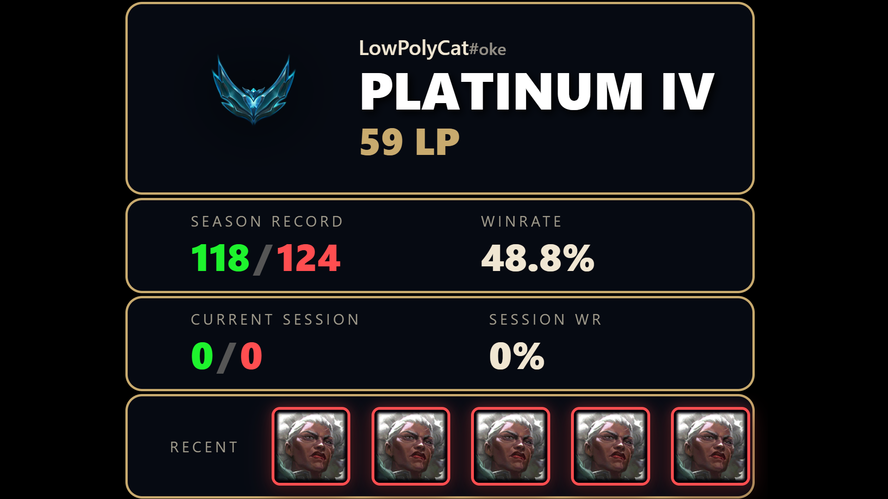

# LoLobs

LoLobs is a rank overlay for League of Legends streams. It shows your rank, LP, win rate and recent games in OBS.

The overlay server reads data from the League Client. It sends the data to the overlay pages through a WebSocket connection.



LoLobs works only on Windows. The `irelia` crate does not build for Linux.

---

## What it does

* **Rank:** The overlay shows your tier, division and LP. It updates when the League Client sends new data.
* **Season stats:** The overlay shows your wins, losses and win rate for this season.
* **Session stats:** The overlay shows your wins, losses, win rate and LP change for the current session.
* **Recent games:** The overlay shows the champions of your last games, the result of each game and your current streak.

---

## Install

### Download a release

1. Go to the [Releases](https://github.com/LowPolyCat1/LoLobs/releases) page of this repository.
2. Download the file `LoLobs-<tag>-windows.zip`.
3. Unzip the file into an empty folder.
   The folder contains `LoLobs.exe`, the `web` folder and `config.example.toml`.
4. Start the League Client.
5. Start `LoLobs.exe`.

### Build from source

To build LoLobs, you need [Rust](https://www.rust-lang.org/tools/install) on Windows.

1. Clone the repository.
2. In the root folder of the repository, run this command:

   ```bash
   cargo build --release
   ```

   The command creates the file `target/release/LoLobs.exe`.
3. Start the League Client.
4. Start the overlay server from the root folder of the repository:

   ```bash
   ./target/release/LoLobs.exe
   ```

To start `LoLobs.exe` from a different folder, copy the `web` folder next to `LoLobs.exe`.

The overlay server looks for the `web` folder in this order:

1. The folder of `LoLobs.exe`.
2. The current working folder.

When the overlay server does not find the `web` folder, it logs an error. Then the overlay pages are not available.

---

## Add the overlay to OBS

When the overlay server starts, it logs the URL of each overlay page.

1. In OBS, add a **Browser Source** to your scene.
2. Set the URL to one of the overlay pages in the table below.
3. Do steps 1 and 2 again for each overlay page that you want to show.

| Overlay page | URL | What the page shows |
| --- | --- | --- |
| Current rank | `http://127.0.0.1:2009/current_rank.html` | Your Riot ID, tier emblem, tier, division and LP. It also shows the LP change of the last game. When your tier or division changes, the emblem shows an animation. |
| Season win rate | `http://127.0.0.1:2009/season_winrate.html` | Your wins, losses and win rate for this season. |
| Session win rate | `http://127.0.0.1:2009/session_winrate.html` | Your wins, losses, win rate and total LP change for the current session. |
| Past matches | `http://127.0.0.1:2009/past_matches.html` | The champions of your last games, the result of each game and your current win or loss streak. |

To show fewer games on the past matches page, add the `matches` parameter to the URL.
For example, `http://127.0.0.1:2009/past_matches.html?matches=3` shows a maximum of 3 games.

When you change the IP address or the port, use the new values in each URL.

---

## Configuration

The overlay server reads the file `config.toml` in the folder of `LoLobs.exe`.
When the file does not exist, the overlay server uses the default values.

To make the file, copy `config.example.toml` to `config.toml` in the folder of `LoLobs.exe`. Then change the values.

| Key | Command line flag | Default | Description |
| --- | --- | --- | --- |
| `ip` | `--ip` | `127.0.0.1` | The IP address of the overlay server. |
| `port` | `--port` | `2009` | The port of the overlay server. |
| `queue` | `--queue` | `solo` | The ranked queue: `solo` for Ranked Solo/Duo, `flex` for Ranked Flex. |
| `match_limit` | `--match-limit` | `5` | The maximum number of games on the past matches page, from 1 to 20. |
| `persist_session` | `--no-persist-session` | `true` | When the value is `true`, the overlay server keeps the session after a restart. |

A command line flag replaces the value from the file. For example:

```bash
LoLobs.exe --queue flex --match-limit 10
```

When the file or a value is not valid, the overlay server logs an error and stops.

### Session

The overlay server keeps the session data in the file `session.json` in the folder of `LoLobs.exe`.
When you start the overlay server again, it uses the same session if these three conditions are true:

* The same account is logged in to the League Client.
* The `queue` setting has the same value.
* The date on your computer is the same day.

When one of these conditions is false, the overlay server starts a new session.

* To start a new session now, start the overlay server with the `--reset-session` flag.
* To start a new session at each start of the overlay server, set `persist_session = false` or use the `--no-persist-session` flag.

---

## How it works

LoLobs has three parts:

1. **League Client listener:** The overlay server uses the `irelia` crate to find the League Client on your computer.
   It subscribes to the events for the summoner, the ranked stats and the match history.
2. **Overlay server:** The overlay server is a Rust program that uses Actix Web.
   It changes the League Client data into typed messages: `summoner`, `ranked` and `matches`.
   It sends each message to all connected overlay pages.
   When an overlay page connects, the overlay server sends the last message of each type.
3. **Overlay pages:** The overlay pages are HTML pages in the `web` folder.
   The script `overlay.js` connects to the overlay server and updates the page for each message.
   It loads the tier emblems and champion icons from CommunityDragon.

For the message format and the overlay page behavior, refer to the [WebSocket API Documentation](./docs.md).

---

## Development

To build and test LoLobs, you need Rust and Node.js.

Before you make a commit, do these checks:

1. Check the format:

   ```bash
   cargo fmt --all -- --check
   ```

2. Run the linter:

   ```bash
   cargo clippy --workspace --all-targets -- -D warnings
   ```

3. Run the Rust tests:

   ```bash
   cargo test --workspace
   ```

4. Run the end-to-end tests of the overlay pages:

   ```bash
   cd e2e
   npm ci
   npx playwright install chromium
   npx playwright test
   ```

### Checks on Linux

The `irelia` crate does not build for Linux. On Linux, build for the Windows target and run the tests with Wine.

1. Install the Rust target `x86_64-pc-windows-gnu` and Wine.
2. Set the test runner:

   ```bash
   export CARGO_TARGET_X86_64_PC_WINDOWS_GNU_RUNNER=wine
   ```

3. Add `--target x86_64-pc-windows-gnu` to the `cargo clippy` and `cargo test` commands. For example:

   ```bash
   cargo clippy --workspace --all-targets --target x86_64-pc-windows-gnu -- -D warnings
   cargo test --workspace --target x86_64-pc-windows-gnu
   ```

---

## Disclaimer

**Riot Games does not support or endorse this project.**

* LoLobs is a third-party application. It uses the LCU API of the League Client.
* LoLobs only reads data. It does not change game files, and it does not give an advantage in the game.
* You use LoLobs at your own risk.
* Riot Games, League of Legends and all related properties are trademarks or registered trademarks of Riot Games, Inc.
